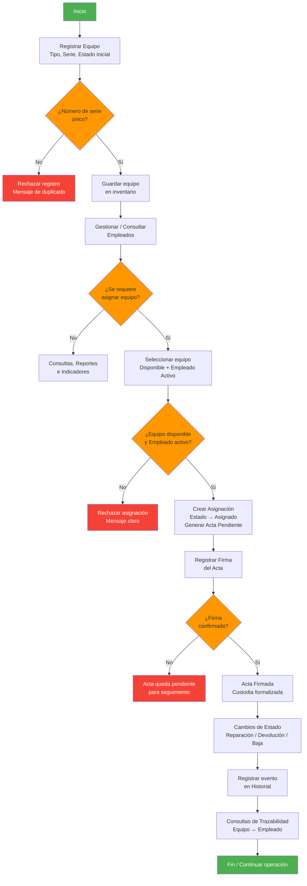

**Leyenda de relación con la ficha:**
- Validaciones alineadas con RN-01, RN-05, RN-08
- Procesos principales según sección 8
- Situaciones no ideales según sección 15
- Trazabilidad bidireccional (RF-09, RF-10)
