# Manual de ayuda y uso de SIGEC

Sistema de Inventario y Gestión de Equipos de Cómputo · Versión 1.0

## 1. ¿Qué es SIGEC?

SIGEC (Sistema de Inventario y Gestión de Equipos de Cómputo) sirve para saber qué equipos tiene la empresa, en qué estado están, quién es el responsable de cada uno y qué les ha pasado (asignaciones, devoluciones y mantenimientos). Cada movimiento queda registrado en el historial del equipo, lo que permite la trazabilidad completa. El sistema se basa en la «Ficha de Documentación y Levantamiento» entregada al cliente (archivo `docs/Ficha_Documentacion_SIGEC.docx`); cuando el sistema cambia, la ficha se actualiza con él.

Con SIGEC puedes: registrar equipos, registrar empleados, asignar equipos a empleados, generar e imprimir actas de entrega, registrar la firma, devolver equipos, programar mantenimientos, sacar reportes en PDF y Excel, administrar usuarios y roles, y pedir ayuda a un asistente de IA que funciona en tu propio equipo.

## 2. Instalación y primer ingreso

### 2.1 Requisitos

Necesitas Windows con Python 3.10 o superior instalado (marca la casilla «Add Python to PATH» al instalarlo) y conexión a internet para llegar a la base de datos en Neon PostgreSQL. No necesitas instalar nada más: los iconos, fuentes y gráficos ya vienen incluidos en el programa.

### 2.2 Cómo iniciar el programa

1. Descomprime la carpeta del proyecto.
2. Haz doble clic en el archivo `ejecutar_sigec.bat`.
3. La primera vez se instalan las dependencias automáticamente; luego se abre el navegador en `http://localhost:5000`.
4. Para detener el programa, cierra la ventana negra o presiona CTRL+C.

Al arrancar, SIGEC crea por sí solo las tablas que falten en la base de datos y conserva los datos que ya existan. No tienes que ejecutar ningún script SQL.

### 2.3 Conexión a la base de datos (archivo .env)

La conexión a Neon está en el archivo `.env` (en la carpeta del proyecto), en la línea `DATABASE_URL`. Si cambias la contraseña en Neon, actualiza esa línea. No compartas el archivo `.env` con nadie: contiene tus claves.

### 2.4 Primer ingreso: usuario Admin

El sistema trae un administrador principal listo para usar. Usuario: `Admin`; la contraseña inicial está indicada en la Ficha de Documentación (el usuario no distingue mayúsculas de minúsculas, la contraseña sí). Después del primer ingreso cambia la contraseña en Configuración → Seguridad. El usuario Admin es el encargado de todo: no se puede eliminar, desactivar ni quitarle el rol de Administrador.

### 2.5 Publicar SIGEC en la nube (Railway)

SIGEC viene listo para Railway: sube la carpeta a GitHub, crea un proyecto en Railway desde ese repositorio, pega las variables (`DATABASE_URL`, `SECRET_KEY`, `DATA_DIR=/data`), crea un volumen montado en `/data` para las fotos, evidencias y respaldos, y genera el dominio público. Los pasos detallados están en el archivo `RAILWAY.md` del proyecto. Al abrir la dirección HTTPS que entrega Railway se usa igual que en el computador, incluido el celular. Cambia la contraseña de Admin en el primer ingreso. La dirección `/health` indica si el servicio está arriba.

### 2.6 Usar SIGEC desde el celular

SIGEC se adapta solo al tamaño de la pantalla (desde 320 px de ancho), sin instalar nada: abre la misma dirección en el navegador del celular o la tableta (si el servidor está en tu computador, escribe en el archivo `.env` la línea `HOST=0.0.0.0`, reinicia SIGEC y abre en el celular `http://IP-DEL-COMPUTADOR:5000` desde la misma red wifi, por ejemplo `http://192.168.1.20:5000`; permite el acceso en el firewall si Windows lo pide. Mientras no cambies `HOST`, SIGEC solo se abre en el propio computador).

En el modo móvil: el menú se abre con el botón de las tres rayas y se cierra al tocar una opción o el fondo; el título y tu foto quedan fijos arriba; las tablas se muestran como tarjetas (una por registro, con cada dato rotulado); los formularios ocupan todo el ancho con botones grandes; los filtros se acomodan en dos columnas; y el asistente de IA se abre como un panel a lo ancho de la pantalla.

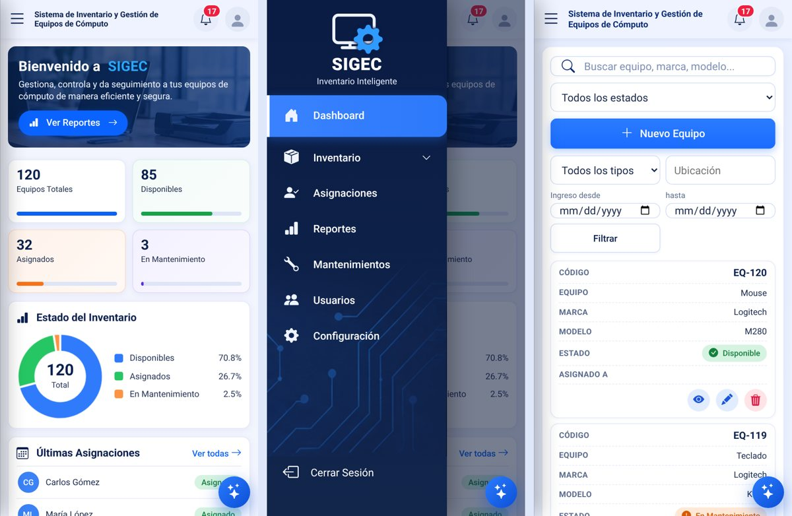

## 3. Iniciar y cerrar sesión

### 3.1 Iniciar sesión

Escribe tu usuario y contraseña en la pantalla de inicio (con el logo de SIGEC); cada campo muestra una guía («Digite su usuario» y «Digite su contraseña»). Luego pulsa «Ingresar». La sesión se cierra automáticamente tras 60 minutos sin actividad.

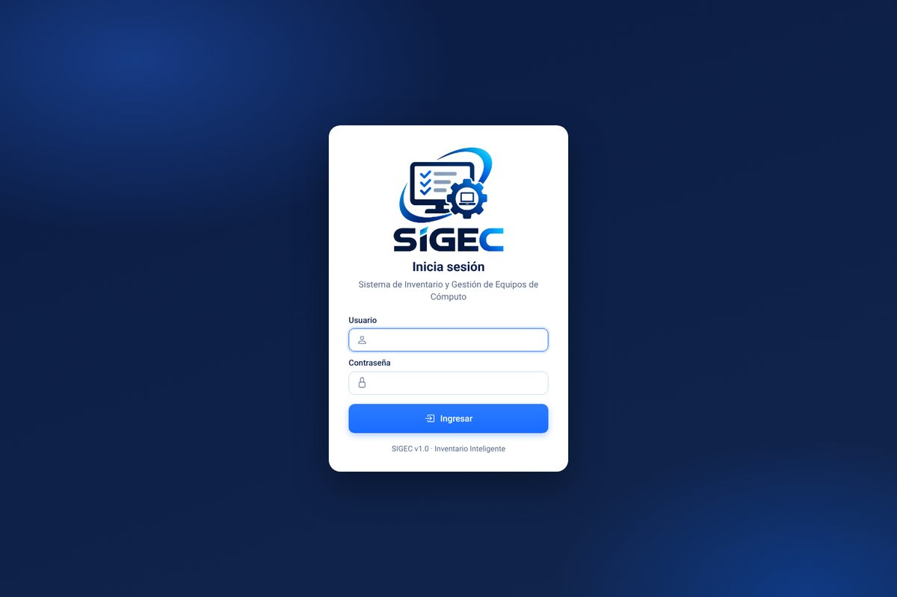

### 3.2 Bloqueo por intentos fallidos

Si te equivocas 5 veces seguidas con el mismo usuario, el ingreso se bloquea durante 5 minutos. Espera ese tiempo e intenta de nuevo.

### 3.3 Cerrar sesión

Pulsa «Cerrar Sesión» en la parte inferior del menú lateral, o abre el menú de tu nombre (arriba a la derecha) y elige «Cerrar sesión».

### 3.4 Mi foto de perfil

Al entrar, el círculo de tu perfil (arriba a la derecha) aparece vacío. Abre el menú de tu nombre y elige «Poner foto de perfil» para subir una imagen PNG, JPG o WEBP de hasta 4 MB; SIGEC la recorta a cuadrado. Con «Cambiar foto de perfil» la reemplazas y con «Quitar foto» vuelve a quedar vacío. Cada usuario administra solo su propia foto.

### 3.5 Cambiar mi contraseña

Abre el menú de tu nombre y elige «Cambiar contraseña». Debes escribir la contraseña actual, la nueva (mínimo 8 caracteres) y confirmarla. El administrador también puede hacerlo en Configuración → Seguridad.

## 4. Panel inicial (Dashboard)

El Dashboard es la pantalla de bienvenida. Muestra cuatro tarjetas con los indicadores principales: Equipos Totales, Disponibles, Asignados y En Mantenimiento (los equipos dados de baja no se cuentan). Debajo está la gráfica «Estado del Inventario» con los porcentajes, la lista de «Últimas Asignaciones» y una tabla con el «Inventario Reciente» desde donde puedes ver, editar o dar de baja un equipo.

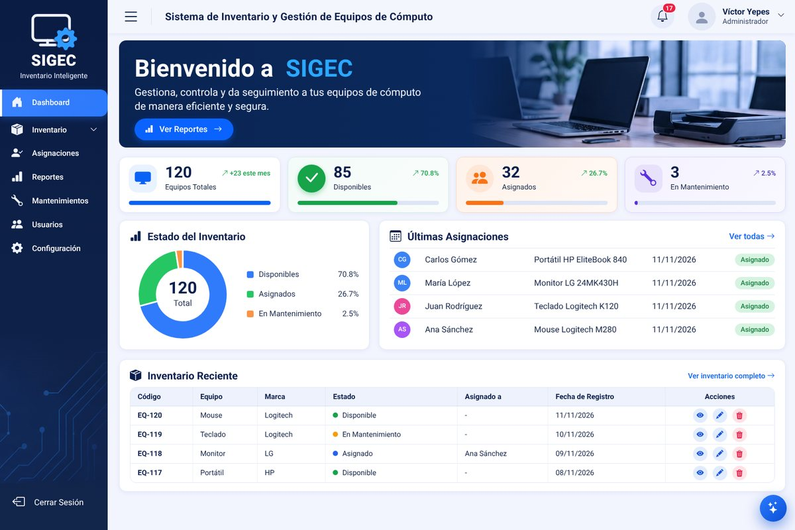

La campana de arriba muestra avisos pendientes (actas sin firmar y mantenimientos en proceso). El botón «Ver Reportes» te lleva a la sección de reportes. El botón de las tres rayas oculta o muestra el menú lateral.

## 5. Inventario de equipos

### 5.1 Ver y buscar equipos

Entra a Inventario → Equipos. Verás la lista con código, tipo, marca, modelo, estado y a quién está asignado. Usa la barra de búsqueda para encontrar por código (por ejemplo EQ-005), marca, modelo, serie, tipo o nombre del responsable, y el filtro «Todos los estados» para ver solo un estado. Con los filtros de la segunda fila también puedes elegir un tipo de equipo, elegir una ubicación de la lista y fijar un rango de fechas de ingreso («Ingreso desde / hasta»); los filtros se aplican solos al elegir una opción, escribir (la búsqueda se actualiza mientras escribes) o cambiar una fecha, sin necesidad de pulsar nada; el botón «Filtrar» queda como alternativa y, para borrar los filtros, «Limpiar». La lista se divide en páginas de 10 registros.

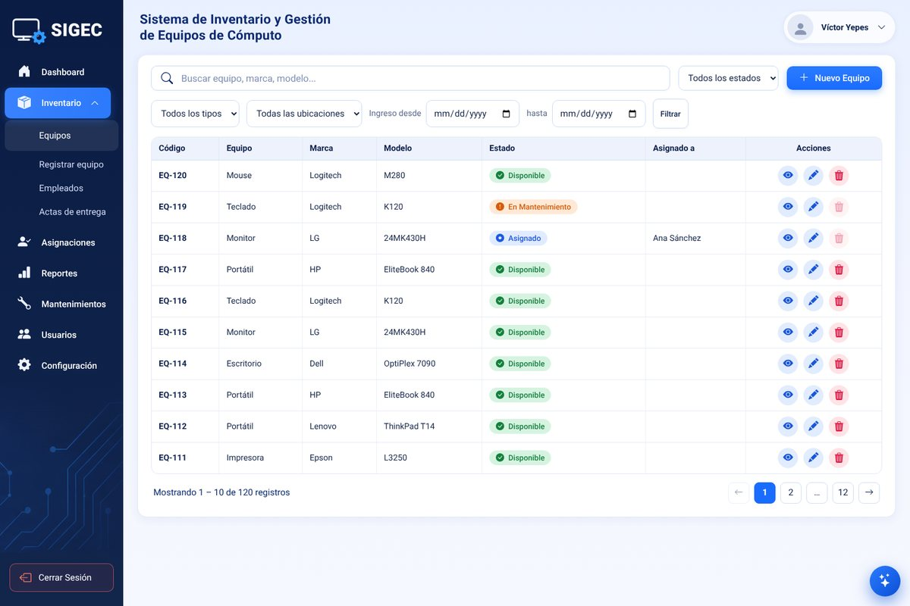

El código del equipo se genera solo a partir de su número de registro (EQ-001, EQ-002, ...).

### 5.2 Registrar un equipo nuevo

1. Entra a Inventario → Equipos y pulsa «Nuevo Equipo» (o usa Inventario → Registrar equipo).
2. Elige el tipo, la marca y la ubicación (todas son listas desplegables) y completa modelo y número de serie. Placa, ubicación y características son opcionales. Si la marca o la ubicación que necesitas no aparece, el Administrador la agrega en Configuración → Catálogos (sección 13.2). Así todos los equipos quedan escritos de la misma forma.
3. Pulsa «Registrar Equipo».

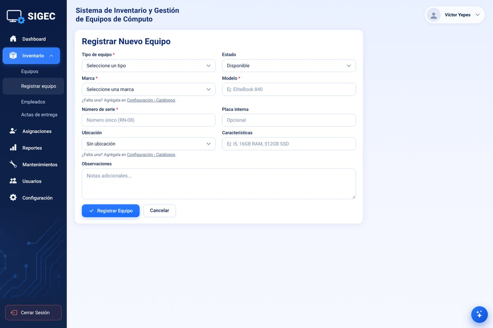

El número de serie no se puede repetir y la placa interna, si la escribes, tampoco (regla RN-08). Si ya existe, SIGEC avisa y no guarda. El estado inicial puede ser Disponible o En recepción.

### 5.3 Editar un equipo

Pulsa el lápiz azul en la fila del equipo, cambia los datos y guarda. Desde aquí no se cambia el estado: para eso usa «Cambiar estado» en el detalle del equipo (sección 5.6).

### 5.4 Dar de baja un equipo

Solo el Administrador ve el botón rojo (papelera). Al pulsarlo, SIGEC pide el motivo de la baja (obligatorio). Dar de baja retira el equipo del inventario activo pero conserva todo su historial; no se borra nada. No se puede dar de baja un equipo que está Asignado o En Mantenimiento: primero registra la devolución o completa el mantenimiento.

### 5.5 Detalle e historial de un equipo

Pulsa el ojo azul para ver el detalle: datos completos, responsable actual y el historial de movimientos (alta, asignaciones, devoluciones, mantenimientos, cambios de estado) con fecha, usuario y cambio de estado.

### 5.6 Cambiar el estado de un equipo

Abre el detalle del equipo y usa el panel «Cambiar estado»: elige el nuevo estado, escribe el motivo (obligatorio, regla RN-06) y pulsa «Aplicar». Reglas: no se puede pasar a Asignado a mano (usa Asignar equipo); si el equipo estaba asignado, la asignación activa se cierra (por ejemplo por pérdida o daño); al pasar a En Mantenimiento se crea el registro de mantenimiento y al salir de ese estado se completa; «Dado de baja» es definitivo y solo lo aplica el Administrador. Todo queda en el historial con el motivo.

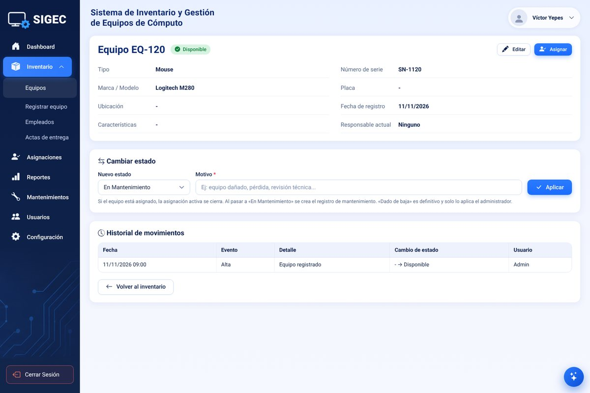

### 5.7 Estados de un equipo

Además de estos cinco estados, el Administrador puede crear otros en Configuración → Catálogos. Disponible: listo para asignar. Asignado: entregado a un empleado. En Mantenimiento: en revisión o reparación. En recepción: recién ingresado o devuelto, pendiente de revisar. Dado de baja: retirado del inventario.

## 6. Empleados

Pulsa el nombre del empleado (o el ojo azul) para abrir su ficha: datos, equipos que tiene asignados hoy, estado de sus actas y el historial de asignaciones anteriores.

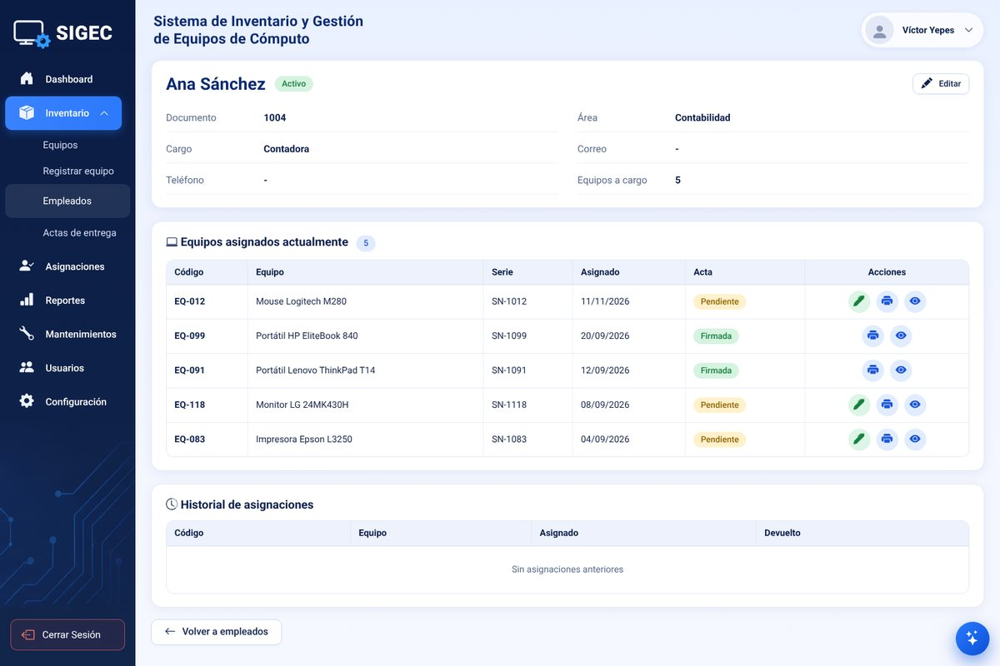

Entra a Inventario → Empleados. Allí se listan los empleados con documento, nombre, área, cargo, cuántos equipos tienen y su estado. Para registrar uno nuevo pulsa «Nuevo Empleado», completa documento, nombres y correo (obligatorios), elige el área y el cargo de las listas desplegables y guarda. El documento no se puede repetir y el correo debe ser válido (por ejemplo nombre@empresa.com); es un dato de contacto y no se usa para iniciar sesión. Las áreas y los cargos los mantiene el Administrador en Configuración → Catálogos (sección 13.2).

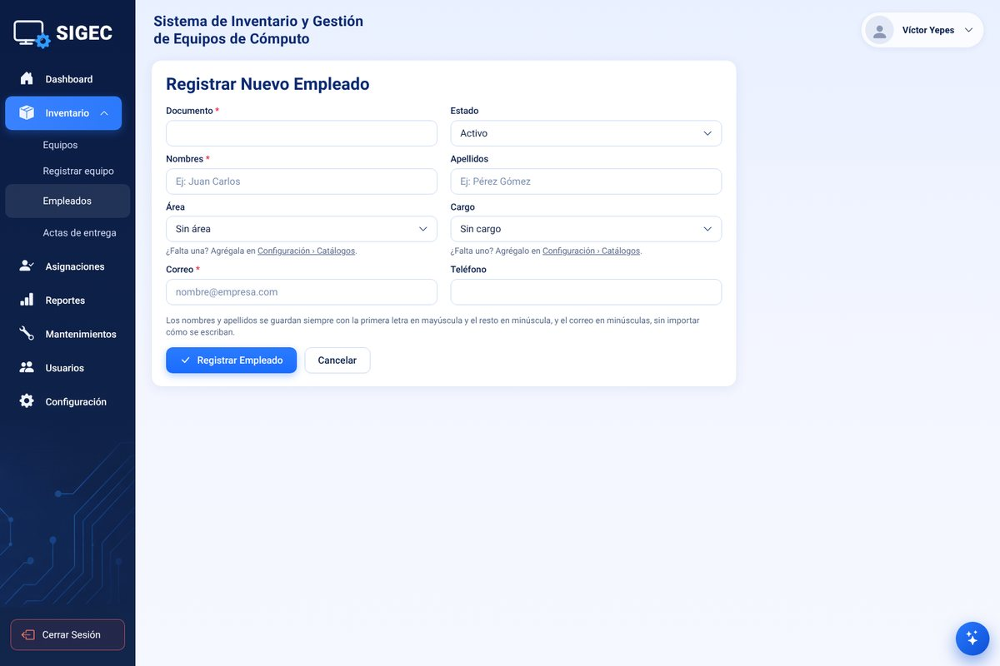

Sin importar cómo se escriba, SIGEC guarda los nombres y apellidos con la primera letra de cada palabra en mayúscula y el resto en minúscula («julian VENEGAS» se ve siempre como «Julian Venegas»), conservando conectores como «de» o «del» en minúscula, y guarda el correo en minúsculas. Los empleados antiguos que no tenían correo recibieron uno provisional con su nombre (nombre.apellido@ejemplo.com); corrígelo la próxima vez que edites su ficha.

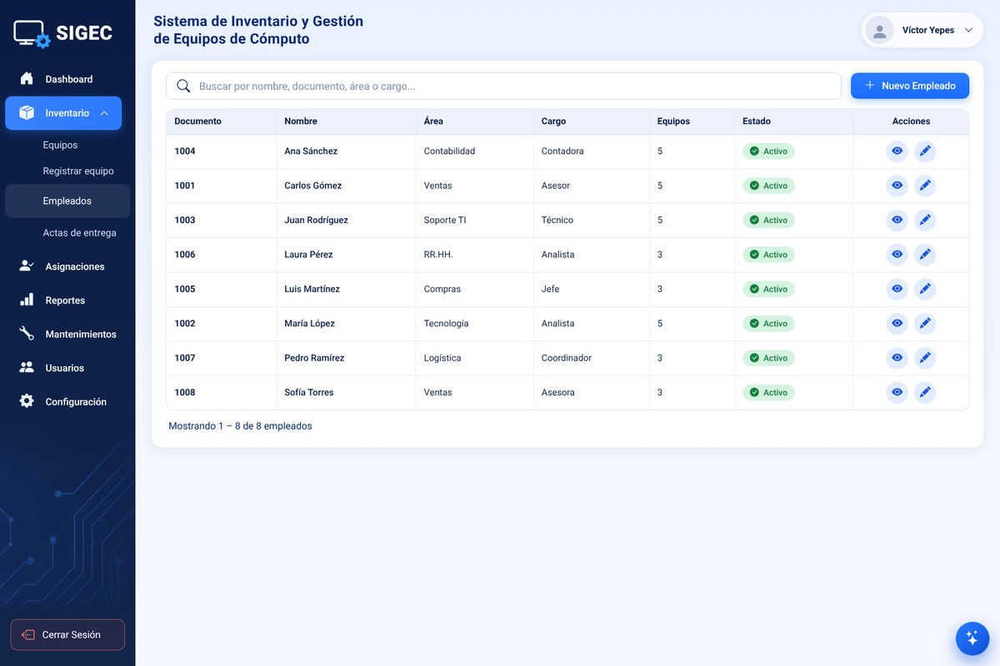

Solo se pueden asignar equipos a empleados en estado Activo (regla RN-05). No se puede inactivar a un empleado que todavía tiene equipos asignados: primero registra las devoluciones.

## 7. Asignar equipos a un empleado

1. Entra a Asignaciones.
2. En «Datos de la Asignación» elige el empleado y agrega uno o varios equipos: elígelos en la lista «Agregar un equipo…» o pulsa el botón azul «+» en la lista de «Equipos Disponibles» de la derecha (el buscador filtra esa lista y «Agregar todos los que se ven» suma los que estén visibles). Cada equipo elegido aparece como una etiqueta que se quita con la «×» (o pulsando de nuevo el botón, que ahora muestra ✓).
3. Confirma la fecha de asignación (no puede ser futura) y escribe observaciones si hace falta.
4. Pulsa «Asignar Equipo» (el botón indica cuántos: «Asignar 3 equipos»).

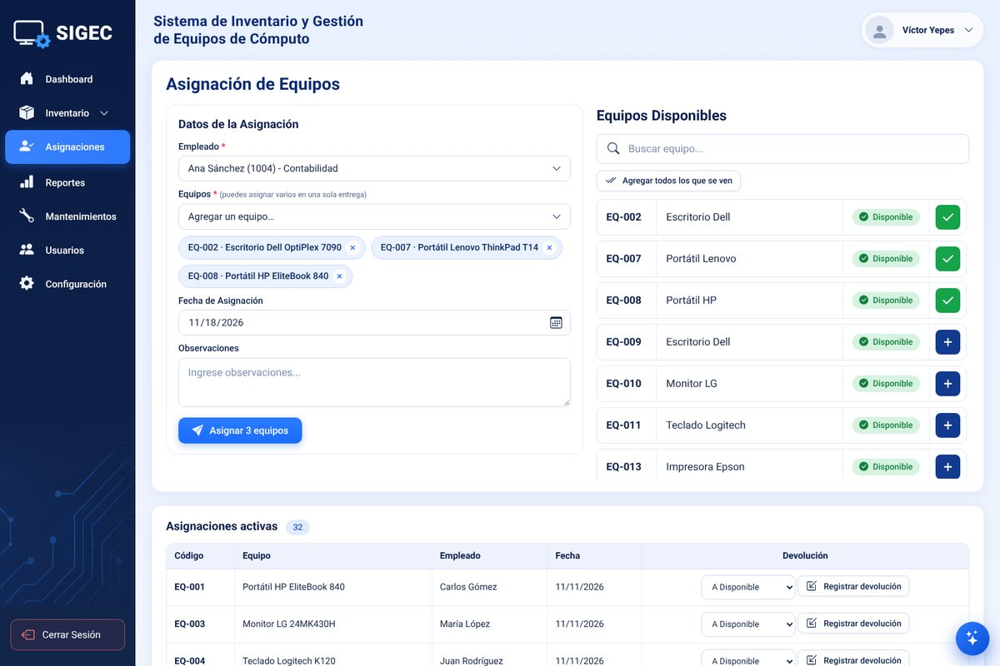

Solo se pueden asignar equipos en estado Disponible (regla RN-01). Al asignar, los equipos pasan a Asignado, se genera automáticamente **una sola acta de entrega** que lista todos los equipos de esa entrega (pendiente de firma, con una sola firma) y se registra el movimiento en el historial de cada equipo. Si alguno de los equipos elegidos dejó de estar Disponible, no se asigna ninguno y SIGEC lo avisa, para que la entrega nunca quede a medias. Una entrega admite hasta 30 equipos. Cada equipo conserva su propia asignación, así que después puedes devolver uno solo sin afectar a los demás.

## 8. Registro de entrega y actas

### 8.1 Pantalla «Registro de Entrega»

Después de asignar, SIGEC muestra «Entrega Registrada con Éxito» con los equipos entregados, el empleado y la fecha. Desde allí pulsa «Imprimir Acta» para abrir el acta lista para imprimir o guardar como PDF, o «Volver» para seguir asignando.

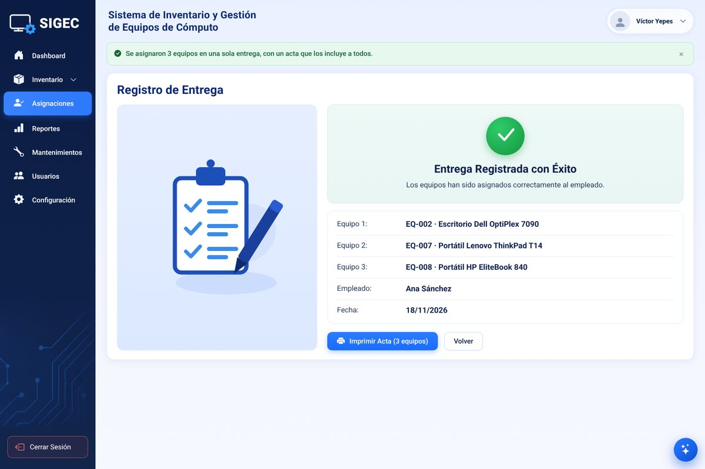

### 8.2 Lista de actas

Entra a Inventario → Actas de entrega. Puedes filtrar por Todas, Pendientes o Firmadas. Cada acta tiene su número, el equipo (o los equipos, con su cantidad, si la entrega fue de varios), el empleado y su estado.

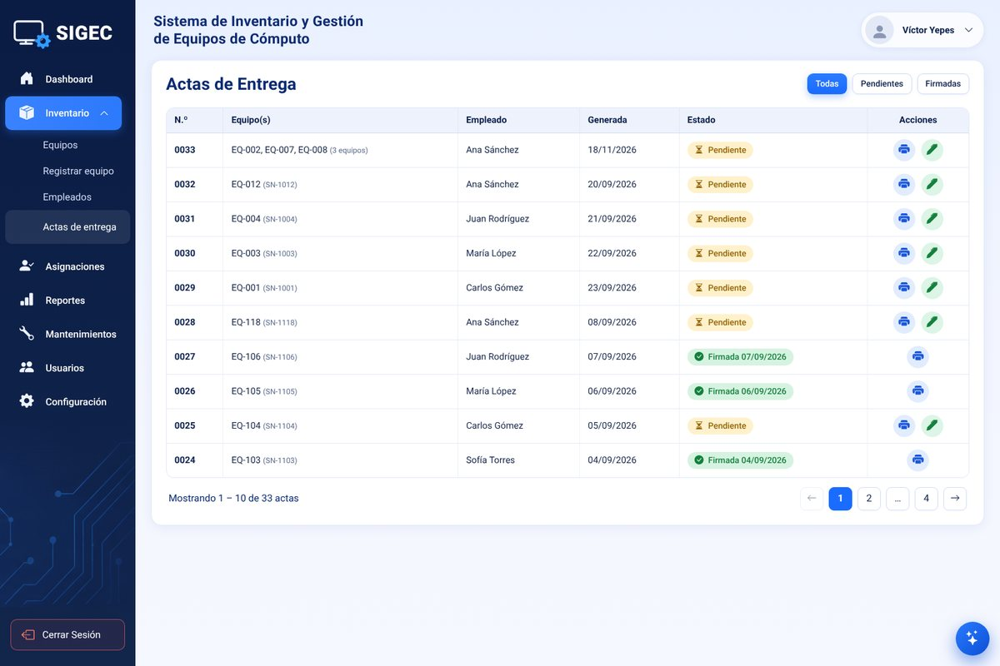

### 8.3 Firmar un acta

Pulsa el botón verde de la pluma en la fila del acta. Se abre la pantalla «Firmar Acta de Entrega»: confirma quién firma, adjunta si quieres la evidencia (foto PNG/JPG o PDF del acta firmada, máximo 5 MB), escribe observaciones y pulsa «Registrar firma». Si la entrega incluye varios equipos, la pantalla los lista todos y una sola firma cubre la entrega completa. Solo se puede firmar si al menos una de las asignaciones del acta sigue activa (regla RN-04). El acta queda en estado Firmada con fecha y quien firmó; la evidencia se ve con el icono del clip y la firma queda en el historial de cada equipo. Un usuario con rol Empleado puede firmar sus propias actas. Las actas pendientes aparecen como aviso en la campana.

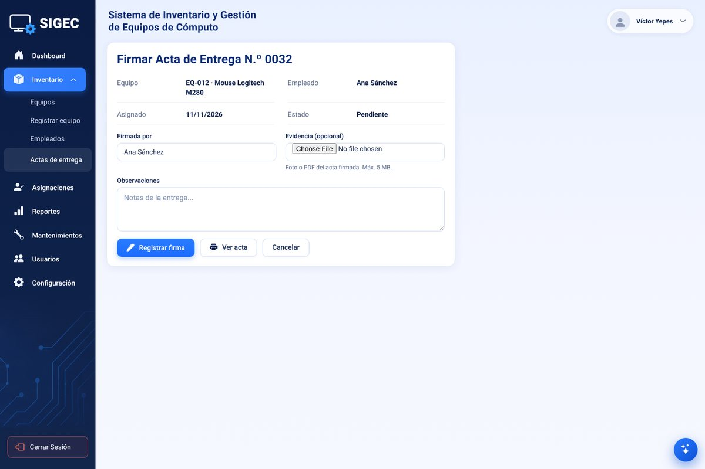

### 8.4 Imprimir un acta

Pulsa el icono de impresora en la fila del acta. Se abre una hoja con los datos del equipo (o una tabla con todos los equipos entregados), del responsable y los espacios de firma. Usa el botón «Imprimir / Guardar como PDF».

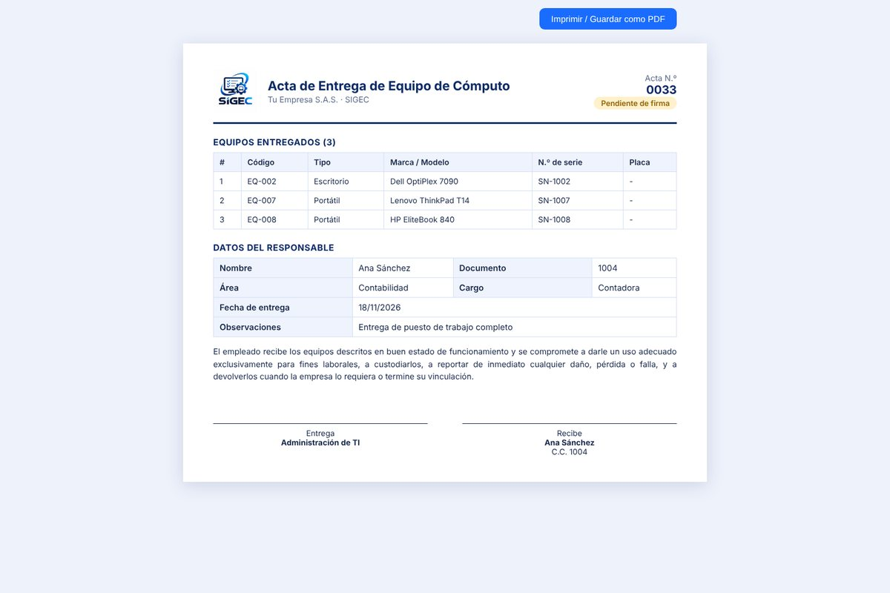

## 9. Devolver un equipo

Hay dos caminos. En Asignaciones, en la tabla «Asignaciones activas», pulsa «Registrar devolución» en la fila del equipo. O abre el detalle del equipo y pulsa «Registrar devolución». Confirma. Antes de pulsar «Registrar devolución» elige el destino del equipo (A Disponible, A En recepción o A Mantenimiento). La asignación se cierra y el historial queda registrado. Si el equipo hacía parte de una entrega de varios equipos, se devuelve solo ese: los demás siguen asignados al empleado y su acta no cambia.

## 10. Mantenimientos

### 10.1 Registrar un mantenimiento

1. Entra a Mantenimientos.
2. En «Registrar Mantenimiento» elige el equipo (solo aparecen equipos Disponibles), el responsable (un usuario con rol Mantenimiento; puedes dejarlo «Sin asignar»), el tipo (Preventivo o Correctivo), la fecha y una descripción.
3. Pulsa «Guardar».

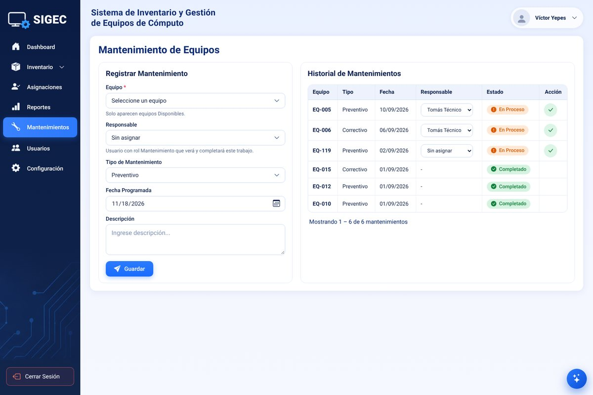

El equipo pasa a «En Mantenimiento» y deja de poder asignarse. Si el equipo está asignado, primero registra su devolución.

### 10.2 Completar un mantenimiento

En el «Historial de Mantenimientos» pulsa el botón verde con el check en la fila del mantenimiento «En Proceso» y confirma. El mantenimiento queda Completado y el equipo vuelve a estar Disponible. Pueden completarlo el Administrador, el Operador y el responsable asignado.

### 10.3 Responsable y rol Mantenimiento

Cada mantenimiento puede tener un responsable: un usuario con rol Mantenimiento. Se elige al registrarlo o después, con la lista «Responsable» de la tabla (disponible para Administrador y Operador mientras el mantenimiento está «En Proceso»); también sirve para asignar los mantenimientos que nacen de un cambio de estado o de una devolución, que quedan «Sin asignar». El cambio de responsable queda en el historial del equipo.

El usuario con rol Mantenimiento solo ve el módulo Mantenimientos (no ve inventario, reportes ni el resto del sistema). En él aparecen únicamente los mantenimientos que le asignaron y solo puede completar esos. Para crearlo: Usuarios → Nuevo Usuario → rol Mantenimiento (no necesita ficha de empleado).

## 11. Reportes

Entra a Reportes. Elige el rango de fechas (desde y hasta): el reporte se actualiza solo al cambiar una fecha, un usuario o un equipo, sin pulsar nada (si «desde» es posterior a «hasta», no se aplica hasta corregirlo); «Generar Reporte» queda como alternativa. Si quieres, elige también un usuario (empleado) o un equipo en las listas desplegables: el reporte se limita a esa persona o a ese equipo (con «Quitar filtros» vuelves al reporte general). Verás la gráfica «Equipos por Estado», la gráfica «Equipos por Tipo», las tablas de asignaciones, mantenimientos (con su responsable) y movimientos dentro del rango y los indicadores: tasa de mantenimiento (equipos con mantenimiento en el rango sobre el total), asignaciones cerradas, actas pendientes de firma con sus días de espera, equipos asignados por área y equipos sin movimiento (más de 90 días por defecto; el umbral se cambia en Configuración → Respaldos).

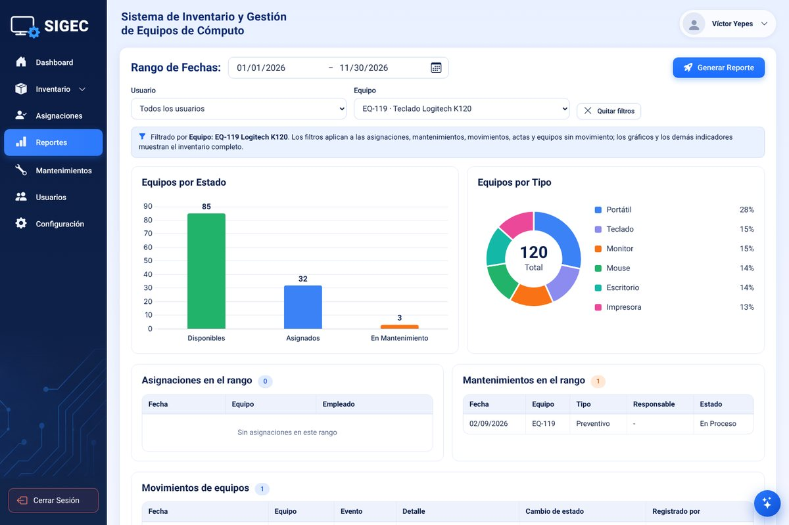

La tabla «Movimientos de equipos» es el historial: altas, asignaciones, devoluciones, cambios de estado, mantenimientos y bajas, con fecha, detalle, cambio de estado y quién lo registró. Con un equipo elegido muestra todo lo que le ha pasado; con un usuario elegido muestra los movimientos de los equipos mientras los tuvo a su cargo. Los filtros aplican a asignaciones, mantenimientos, movimientos, actas y equipos sin movimiento; los gráficos y los demás indicadores siguen mostrando el inventario completo.

### 11.1 Exportar a PDF o Excel

Pulsa «Exportar PDF» o «Exportar Excel» (abajo de la pantalla). Se descarga un archivo con el resumen e indicadores, los equipos por estado y tipo, las asignaciones, los mantenimientos, los movimientos, los equipos registrados, las actas pendientes, los equipos sin movimiento y los asignados por área. El Excel trae una hoja por cada sección. Si hay un filtro de usuario o equipo, los archivos salen con ese mismo filtro y lo indican.

## 12. Usuarios y roles

### 12.1 Crear un usuario

Solo el Administrador ve la sección Usuarios. Pulsa «Nuevo Usuario», escribe usuario (3 a 30 caracteres: letras, números, punto, guion), nombre, rol, una contraseña de mínimo 8 caracteres y, si quieres, el empleado vinculado. El nombre completo se guarda con la primera letra de cada palabra en mayúscula. Para el rol Empleado es obligatorio tener ficha de empleado: elige uno existente o escribe el documento y el correo del empleado (dato de contacto; no se usa para iniciar sesión) y SIGEC crea la ficha con el nombre completo y la vincula, de modo que la persona vea sus equipos desde su primer ingreso. El usuario no se puede repetir y un empleado solo se vincula a un usuario.

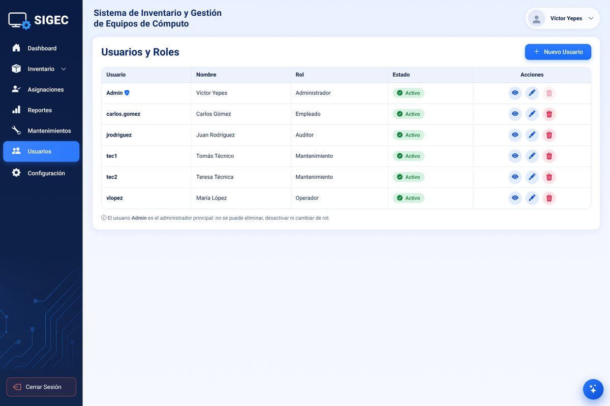

### 12.2 Editar, desactivar o eliminar

Con el lápiz cambias nombre, rol y contraseña, generas una contraseña temporal si la persona olvidó la suya (sección 16.3), y puedes desactivar al usuario (deja de poder ingresar, incluso si estaba conectado). Con la papelera lo eliminas definitivamente. No puedes eliminar ni desactivar tu propio usuario, ni al usuario Admin.

### 12.3 Roles y permisos

| Rol | Qué puede hacer |
| Administrador | Todo: inventario, asignaciones, mantenimientos, reportes, usuarios, configuración y dar de baja equipos |
| Operador | Registrar y editar equipos y empleados, asignar, devolver, firmar actas, mantenimientos y reportes |
| Auditor | Consultar inventario, actas, mantenimientos y reportes (solo lectura) |
| Jefe | Consultar inventario, actas, mantenimientos y reportes (solo lectura; en esta versión ve todas las áreas) |
| Mantenimiento | Solo el módulo Mantenimientos: ve y completa los mantenimientos que se le asignan; no ve el resto del sistema |
| Empleado | Solo ve «Mis equipos» y sus propias actas, y puede firmarlas; no accede al resto del inventario |

### 12.4 El rol Empleado y «Mis equipos»

Cuando un usuario con rol Empleado entra, ve «Mis equipos» (los equipos que tiene a cargo, su historial de asignaciones y el estado de sus actas) y «Mis actas». Si su usuario no está vinculado a un empleado, verá un aviso para pedir al administrador que lo vincule.

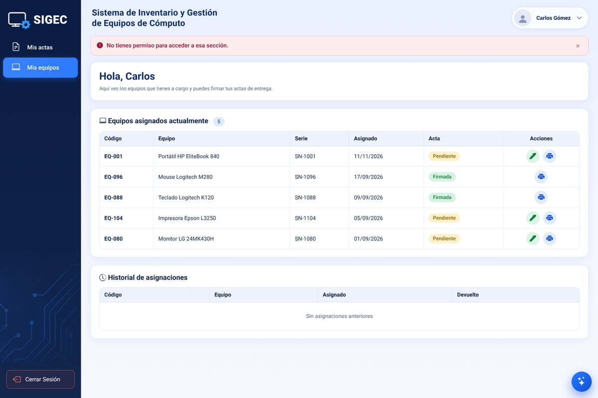

## 13. Configuración

Solo el Administrador ve Configuración. Tiene cinco pestañas: General, Catálogos, Notificaciones, Respaldos y Seguridad.

### 13.1 General

Muestra el nombre del sistema y la versión, y permite cambiar el nombre de la Empresa (aparece en las actas y reportes) y la zona horaria (afecta las fechas y horas que se registran). Si hay una clave de Claude configurada, aparece también la casilla «Usar Claude en el asistente» (sección 14). Pulsa «Guardar Configuración».

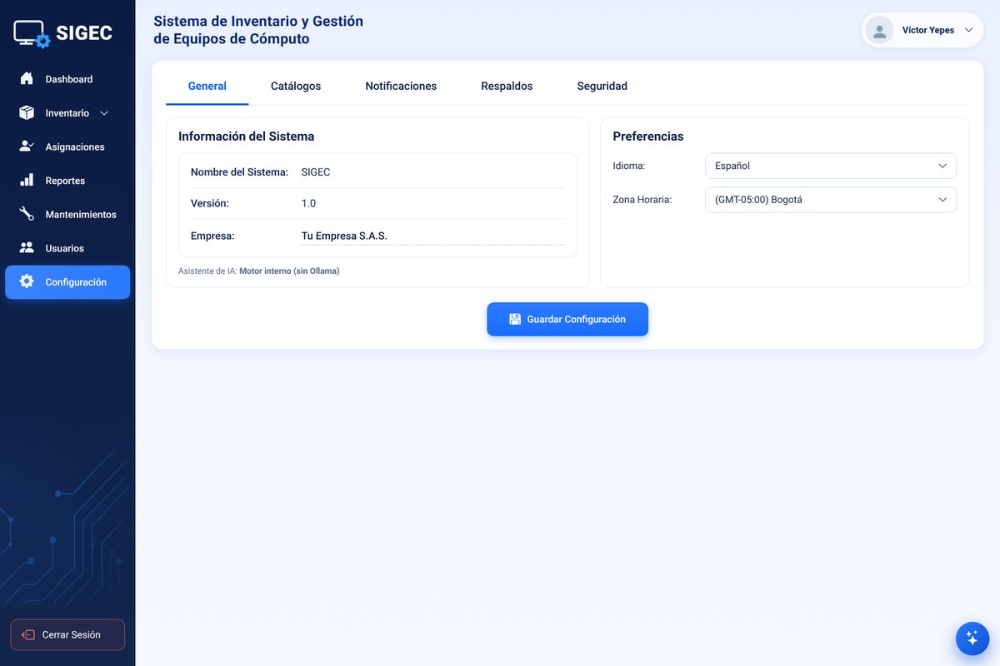

### 13.2 Catálogos

En la pestaña Catálogos el Administrador mantiene los tipos de equipo, los estados de equipo, las marcas, las áreas, las ubicaciones y los cargos (crear, renombrar, activar o desactivar). Las marcas, áreas, ubicaciones y cargos son las listas desplegables de los formularios de equipos y de empleados (marca y ubicación en equipos; área y cargo en empleados): lo que se agregue aquí aparece de inmediato allí, un nombre cambiado se actualiza también en los registros que lo usan, y una opción desactivada deja de ofrecerse sin alterar lo ya guardado. Los cinco estados base (Disponible, Asignado, En Mantenimiento, En recepción y Dado de baja) están protegidos: no se renombran ni se desactivan (regla RN-12). Un estado propio, por ejemplo «En investigación», se puede crear, renombrar y desactivar si no tiene equipos. Los nombres de marcas, áreas, ubicaciones y cargos se guardan siempre con la primera letra de cada palabra en mayúscula («almacen» queda «Almacen»); las siglas de hasta 3 letras escritas en mayúsculas (TI, HP, LG) y las abreviaturas con puntos (RR.HH.) se respetan. SIGEC no puede agregar tildes por sí solo: si quieres «Almacén», renómbralo aquí y se actualiza en todos los registros. Los valores que ya existían en equipos y empleados pasaron automáticamente a estos catálogos.

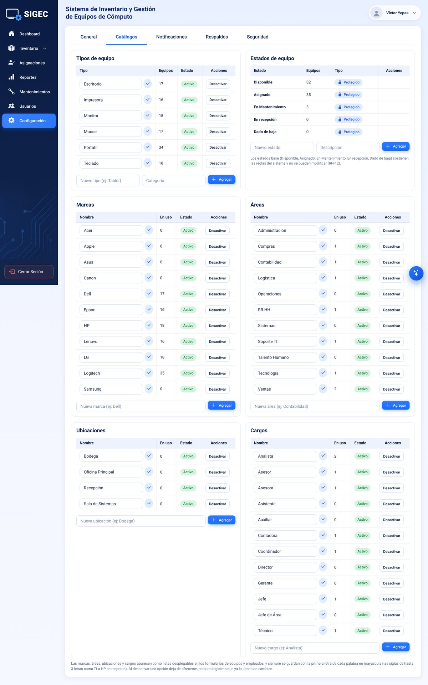

### 13.3 Notificaciones

Elige qué avisos aparecen en la campana: actas pendientes de firma y mantenimientos en proceso.

### 13.4 Respaldos

Pulsa «Descargar respaldo ahora» para bajar una copia completa de los datos en un archivo JSON. No incluye las contraseñas de los usuarios. Guarda el archivo en un lugar seguro. Además, mientras SIGEC esté en ejecución genera un respaldo automático por día en la carpeta `respaldos/` (se conservan los últimos 14); puedes activarlo o desactivarlo en el bloque «Operación», donde también se fija el umbral de días de «equipos sin movimiento». Neon conserva sus propias copias según tu plan.

### 13.5 Seguridad

Permite cambiar tu contraseña. Recuerda: mínimo 8 caracteres, la sesión se cierra tras 60 minutos sin actividad y 5 intentos fallidos bloquean el ingreso por 5 minutos.

## 14. Asistente de IA

### 14.1 Cómo usarlo

En la esquina inferior derecha hay un botón azul con destellos. Púlsalo para abrir el asistente. Puedes preguntarle cómo hacer algo («¿cómo asigno un equipo?», «¿cómo firmo un acta?») o consultar datos reales del inventario («¿cuántos equipos hay disponibles?», «estado del equipo EQ-005», «¿cuántas actas están pendientes?»). También hay preguntas sugeridas para empezar, distintas según tu rol.

Puedes escribirle como hablas: con faltas de ortografía, frases cortas o a medias («y el portatil de juan?», «cuales estan en mantenimiento», «quien tiene el 5»). Si tienes activo el motor Claude (sección 14.2), entiende cualquier formulación, recuerda lo que hablaron antes en la misma conversación y puede combinar varias consultas, por ejemplo: «¿qué equipos tiene María y cuáles están sin firmar?», «¿cuántos portátiles Dell hay por área?», «¿qué movimientos tuvo el EQ-003 este mes?» o «equipos que llevan meses sin moverse». Cuando le preguntes cómo hacer algo, te explica los pasos y te da un enlace a la pantalla correspondiente.

El asistente solo consulta; nunca crea, modifica ni elimina datos. Respeta tu rol: un Empleado solo obtiene información de sus propios equipos y actas, y Mantenimiento solo de los trabajos que tiene asignados. Para evitar abusos hay un tope de 30 preguntas cada 10 minutos por usuario.

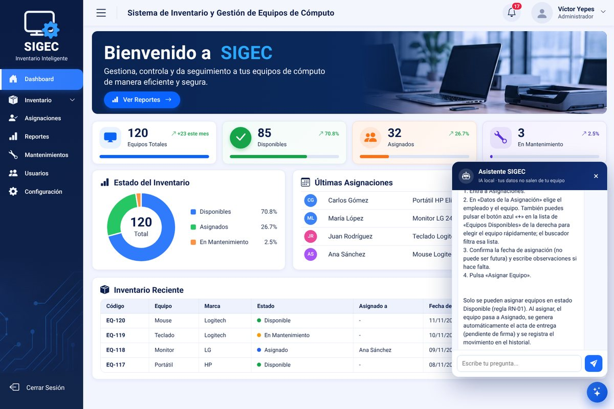

### 14.2 Cómo funciona (tres motores)

El asistente elige solo el mejor motor disponible, y si uno falla pasa al siguiente, así que nunca se queda sin responder. Debajo de cada respuesta se muestra qué motor respondió.

1. **Claude (opcional).** Si el Administrador configura la clave de la API de Anthropic en la variable de entorno `ANTHROPIC_API_KEY` (en Railway: pestaña Variables; en tu equipo: archivo `.env`), el asistente usa Claude. Conoce todo este manual y consulta el inventario mediante herramientas de solo lectura. Por defecto usa el modelo `claude-sonnet-5-5`; se puede cambiar con `ANTHROPIC_MODEL`. Con este motor, la pregunta y los datos consultados para responderla se envían a Anthropic para generar la respuesta. El Administrador puede apagarlo cuando quiera en Configuración → General («Usar Claude en el asistente»), y la clave nunca se guarda en el código ni en la base de datos. Si la API rechaza la clave o se alcanza su límite de uso, SIGEC lo detecta, se pausa unos minutos y usa los otros motores.
2. **Ollama (opcional, solo en tu equipo).** Si lo tienes instalado, SIGEC lo detecta y usa un modelo de lenguaje local (sección 14.3).
3. **Motor interno.** Viene incluido y no requiere instalar nada: busca la respuesta en este manual y consulta la base de datos. Sin la clave de Claude, todo funciona dentro de tu propio equipo o servidor y ninguna pregunta sale a internet.

### 14.3 Activar el modelo de lenguaje local (opcional)

1. Descarga e instala Ollama desde ollama.com (gratis).
2. Abre una ventana de comandos y escribe `ollama pull llama3.2:3b` para descargar el modelo (unos 2 GB).
3. Deja Ollama en ejecución y recarga SIGEC. En Configuración → General verás «Asistente de IA: Ollama».

Para usar otro modelo, cambia `OLLAMA_MODEL` en el archivo `.env`. El asistente aprende de este manual: cuando el manual se actualiza, sus respuestas también (con Claude, el manual completo se le entrega en cada conversación).

### 14.4 Activar Claude (opcional)

1. Crea una clave de API en la consola de Anthropic (console.anthropic.com).
2. Pégala como valor de `ANTHROPIC_API_KEY`: en Railway, en Variables; en tu equipo, en el archivo `.env`. Reinicia SIGEC.
3. En Configuración → General verás «Asistente de IA: Claude (…)» y la casilla «Usar Claude en el asistente».

No compartas la clave por chat ni correo; si se expone, revócala en la consola de Anthropic y crea otra.

## 15. Reglas de negocio

RN-01: solo se pueden asignar equipos en estado Disponible. RN-05: solo se asigna a empleados activos. RN-08: el número de serie de un equipo es único. RN-06: todo cambio de estado exige un motivo. RN-07: al devolver, el operador elige si el equipo queda Disponible, En recepción o En Mantenimiento. RN-12: los estados base están protegidos. Además: un equipo asignado o en mantenimiento no se puede dar de baja y la baja es definitiva; no se inactiva a un empleado con equipos asignados; toda entrega (de uno o varios equipos) genera una sola acta pendiente de firma; el correo del empleado es obligatorio; y todo movimiento queda en el historial con fecha y usuario.

## 16. Solución de problemas

### 16.1 No abre el programa o dice que Python no está instalado

Instala Python desde python.org marcando «Add Python to PATH» y vuelve a ejecutar `ejecutar_sigec.bat`.

### 16.2 Dice «Sin conexión a la base de datos»

Revisa tu conexión a internet y que la línea `DATABASE_URL` del archivo `.env` sea correcta (host, usuario y contraseña de Neon). Si cambiaste la contraseña en Neon, actualízala allí.

### 16.3 Olvidé mi contraseña

Pídele al Administrador que te genere una contraseña temporal: en Usuarios → lápiz → «Generar contraseña temporal». SIGEC crea una clave aleatoria segura y la muestra una sola vez en pantalla (con botón Copiar); el Administrador te la entrega por un medio seguro. Al ingresar con ella, SIGEC te pide crear tu propia contraseña (mínimo 8 caracteres y distinta de la temporal) antes de usar cualquier función. La clave anterior deja de funcionar y, si estabas bloqueado por intentos fallidos, quedas desbloqueado. El Administrador no conoce la contraseña que tú elijas. Si el Administrador genera una clave por error, puede generar otra.

Si olvidaste la contraseña del Admin y no hay otro Administrador que pueda generarla, en Railway define la variable `ADMIN_RESET_PASSWORD` con una clave temporal de al menos 8 caracteres y reinicia el servicio (en tu equipo, ponla en `.env`). Al arrancar, el Admin queda con esa clave temporal y SIGEC le pedirá cambiarla al ingresar. Se aplica una sola vez por cada valor, así que puedes quitar la variable después sin que se repita en cada reinicio. Por eso conviene tener siempre un segundo usuario Administrador.

### 16.4 «Demasiados intentos fallidos»

Espera 5 minutos, reinicia el programa o pide al Administrador que genere una contraseña temporal (sección 16.3), lo que también te desbloquea.

### 16.5 El asistente no usa Claude o responde con el motor interno

Revisa que `ANTHROPIC_API_KEY` esté definida y sea válida, y que la casilla «Usar Claude en el asistente» esté marcada en Configuración → General. Si el estado dice «en pausa», la API rechazó la clave o se alcanzó el límite de uso: corrige la clave o espera unos minutos.

### 16.6 Aparece el aviso «Sigues usando la contraseña inicial del usuario Admin»

Es una advertencia de seguridad: la contraseña inicial del Admin es conocida por quienes tienen la ficha de documentación. Cámbiala en Configuración → Seguridad y el aviso desaparece.

### 16.5 «La sesión del formulario expiró»

Recarga la página e intenta de nuevo. Ocurre si dejaste la pantalla abierta mucho tiempo.

### 16.6 No me aparece un menú o botón

Depende de tu rol. Por ejemplo, Usuarios y Configuración son solo del Administrador, asignar o registrar equipos requiere rol Operador o Administrador, y el rol Mantenimiento solo ve el módulo Mantenimientos.

### 16.7 El asistente dice «Motor interno»

Es normal: significa que no hay Ollama activo y responde con el motor incluido. Funciona igual para ayuda y consultas de datos.

## 17. Historial de versiones del manual

Versión 1.0 (18/11/2026): primera versión completa del sistema y de este manual, alineada con la Ficha de Documentación (v1.0). Incluye diseño visual compacto, roles y permisos (con el rol Mantenimiento y responsable de cada mantenimiento), usuarios con foto, equipos, empleados, catálogos de tipos, estados, marcas y áreas con listas desplegables, asignaciones, cambio de estado con motivo, firma de actas con evidencia, reportes con filtros por usuario y equipo y movimientos, respaldo automático, asistente de IA (motor interno y Ollama locales, y motor opcional con Claude con herramientas de solo lectura), modo responsive para celulares y publicación en Railway. Se agregaron además los catálogos de ubicación y cargo, el correo obligatorio, los textos con mayúsculas automáticas, la asignación de varios equipos con una sola acta, filtros dinámicos en Equipos, Empleados y Reportes, textos guía en el inicio de sesión, el aviso de contraseña inicial del Admin, cabeceras de seguridad, el restablecimiento de contraseñas con clave temporal y cambio obligatorio, y se corrigió la eliminación de usuarios con mantenimientos asignados.
